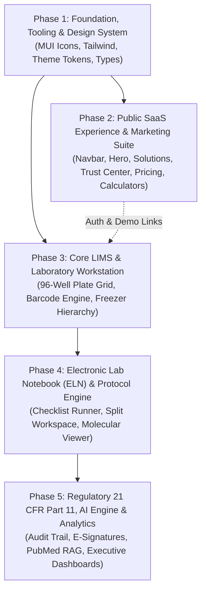

# GatsBio Implementation Plan & Phased Roadmap
## Unified Biotechnology Research, LIMS & Life Sciences Innovation Platform

---

| **Document Version** | 2.0.0 (Updated with MUI Icons & Modular Phasing) |
| :--- | :--- |
| **Status** | Approved & Ready for Active Execution |
| **Core UI Stack** | React 19, TypeScript, Vite, **MUI Icons & Components (`@mui/icons-material`, `@mui/material`)**, Tailwind CSS, `framer-motion` |
| **Scientific Utilities**| `qrcode.react`, `jsbarcode`, `recharts`, `canvas-confetti` |
| **Associated PRD** | [`PRD.md`](file:///d:/MVP/GatesBio/PRD.md) |
| **Associated Design**| [`design.md`](file:///d:/MVP/GatesBio/design.md) |

---

## 1. Architectural Strategy & Phased Breakdown

The implementation of GatsBio is organized into **5 sequential phases**. Each phase is fully decoupled, testable, and builds toward enterprise-grade scientific usability:



---

## 2. Phase 1: Foundation, Tooling & UI Architecture

### 2.1 Goals
Establish the core frontend architecture, install MUI icons and styling packages, define scientific theme tokens, set up routing, and build shared UI primitives.

### 2.2 Tasks & Deliverables

#### Task 1.1: Dependency Installation & Setup
- Install MUI ecosystem:
  ```bash
  npm install @mui/icons-material @mui/material @emotion/react @emotion/styled
  ```
- Install motion, charting, and barcode utilities:
  ```bash
  npm install framer-motion qrcode.react jsbarcode recharts
  npm install -D @types/jsbarcode
  ```
- Configure Tailwind CSS (or Tailwind v4 Vite plugin) with custom CSS variables for:
  - Primary Deep Blue: `#1E40AF`
  - Secondary Teal: `#0F766E`
  - Accent / QC Pass Emerald: `#10B981`
  - Warning Amber: `#F59E0B`
  - Biohazard / OOS Crimson: `#DC2626`

#### Task 1.2: Global Design System & MUI Theme Provider
- Create `src/theme/muiTheme.ts` binding MUI components with GatsBio’s deep blue and teal brand identity.
- Set up font stacks: `Inter` for interface, `JetBrains Mono` for genetic sequences, barcodes, and tabular figures.
- Create reusable UI atom components:
  - `<Button />`: Primary, Secondary, Outline, Danger, Icon-only with MUI icons.
  - `<Badge />`: QC Status (`Pass`, `Fail`, `Quarantine`, `Calibrated`).
  - `<Card />`: Glassmorphic and lab workstation card styles.
  - `<Modal />`: Accessible backdrop dialogs.

#### Task 1.3: TypeScript Interfaces & Mock Data Engine
- Define strict domain types in `src/types/index.ts`:
  - `BioSample`, `WellCoordinate`, `PlateLayout`, `FreezerLocation`
  - `ProjectMilestone`, `ExperimentProtocol`, `ProtocolStep`
  - `AuditLogEntry`, `ESignatureRecord`, `EquipmentAsset`
- Build rich mock data in `src/data/mockData.ts` with realistic biotechnology fixtures (HEK293 cell lines, CRISPR assays, Illumina sequencer runs).

#### Task 1.4: Client-Side Router
- Implement a router supporting seamless navigation between:
  - **Public Routes**: `/` (Home), `/platform`, `/solutions`, `/compliance`, `/pricing`, `/tools` (Calculators), `/demo`
  - **App Lab Routes**: `/app/dashboard`, `/app/lims`, `/app/eln`, `/app/equipment`, `/app/ai`, `/app/compliance`

### 2.3 Phase 1 Acceptance Criteria
- [ ] MUI icons render crisply with zero console warnings.
- [ ] Primary, secondary, and accent color tokens match `design.md`.
- [ ] TypeScript compiles cleanly with `npm run build`.

---

## 3. Phase 2: Public SaaS Experience & Customer Acquisition

### 3.1 Goals
Create a responsive, high-converting public website that conveys scientific credibility to biotech executives, lab directors, principal investigators, and compliance officers.

### 3.2 Tasks & Deliverables

#### Task 2.1: Master Public Navigation (`<PublicNavbar />`)
- **Logo & Branding**: GatsBio helix mark and brand typography.
- **Dropdown Menus with MUI Icons**:
  - **Platform**: LIMS, ELN, Biological Big Data, AI Engine, Equipment IoT, Clinical Trials.
  - **Solutions**: Biopharma, Academic Institutes, CROs, Clinical Diagnostics.
  - **Resources**: Scientific Whitepapers, API Docs, Free Lab Calculators.
- **Direct Navigation Links**: *Trust & Compliance*, *Pricing*.
- **Call-to-Action Buttons**:
  - `Sign In` (Opens quick persona login / app link).
  - `Book a Demo` (Opens consultation modal).
- **Responsive Drawer**: Mobile-friendly slide-over menu for tablet and mobile viewports.

#### Task 2.2: Scientific SaaS Landing Page (`<HomePage />`)
- **Hero Section**:
  - High-impact headline: *"The Unified Operating System for Life Sciences & Biotech Innovation"*.
  - Subhead addressing fragmented lab notebooks, sample loss, and regulatory bottlenecks.
  - Interactive live metrics ticker: *1.2M+ Samples Tracked*, *99.98% Audit Pass Rate*, *65% Shorter Assay Turnaround*.
  - Action buttons: *Launch Interactive Lab Tour* & *Book Private Demo*.
- **Trusted By Section**: Academic medical centers, genomics spinouts, and biopharma logos.
- **Interactive Feature Switcher**:
  - Live tabbed switcher toggling between **LIMS**, **ELN**, **AI Engine**, and **21 CFR Part 11 Compliance** with animated UI preview cards.
- **Pain Points vs. GatsBio Solution**: Side-by-side comparison (Paper notebooks vs. Digital ELN, Spreadsheet silos vs. Barcoded LIMS).
- **Scientific Testimonials**: Quotes from Principal Investigators, Lab Managers, and QA Officers.

#### Task 2.3: Platform & Solutions Showcase Pages
- **`<PlatformPage />`**: Comprehensive overview of the 6 pillars with deep-dive architectural schematics.
- **`<SolutionsPage />`**: Industry-specific tabs for Biopharma, CROs, and Academic Research Labs.

#### Task 2.4: Trust & Regulatory Center (`<CompliancePage />`)
- Visual breakdown of **FDA 21 CFR Part 11**, **GAMP 5**, **HIPAA**, and **ISO 17025**.
- Interactive tamper-evident audit trail simulation showing Merkle hash generation.

#### Task 2.5: Transparent Pricing Page (`<PricingPage />`)
- Monthly vs. Annual toggle with **20% Annual Discount badge**.
- Three tiers:
  1. **Academic & Research** ($49/seat/mo)
  2. **Growth Biotech** ($199/seat/mo)
  3. **Enterprise Biopharma** (Custom / Dedicated VPC / BYOK)
- Feature comparison table and FAQ accordion.

#### Task 2.6: Free Scientific Lab Tools (`<CalculatorsPage />`)
- **Serial Dilution Calculator**: Calculates stock volume, diluent volume, and visualizes dilution curve across wells.
- **DNA/RNA $T_m$ & Primer Annealing Calculator**: Instant calculation of GC content (%) and melting temperature.

#### Task 2.7: Interactive Demo Booking Modal (`<DemoModal />`)
- Step-by-step form capturing lab size, assay focus, and calendar date picker with confirmation animation.

#### Task 2.8: Comprehensive Enterprise Footer (`<PublicFooter />`)
- 5-column navigation, ISO/SOC certification badges, copyright, and newsletter sign-up.

### 3.3 Phase 2 Acceptance Criteria
- [ ] All public routes and dropdowns navigate smoothly.
- [ ] Calculators compute correct dilution and $T_m$ formulas.
- [ ] Mobile responsive layout operates seamlessly on tablet and smartphone screens.

---

## 4. Phase 3: Core LIMS & Laboratory Workstation

### 4.1 Goals
Build the daily driver tools used by laboratory technicians to log specimens, assign microplates, print barcodes, and manage cryogenic storage.

### 4.2 Tasks & Deliverables

#### Task 3.1: Persona Switcher & Authenticated Shell (`<LabAppShell />`)
- Quick persona switcher for testing:
  - *Dr. Elena Vance (PI - Oncology)*
  - *Marcus Chen (Lead Lab Technician)*
  - *David Ross (QA & Compliance Auditor)*
- Collapsible lab sidebar featuring MUI icons (`Biotech`, `QrCodeScanner`, `GridOn`, `Kitchen`, `FactCheck`, `AutoAwesome`).

#### Task 3.2: Interactive 96-Well Microplate Visualizer (`<WellPlateGrid />`)
- 8 rows ($A-H$) $\times$ 12 columns ($1-12$) coordinate matrix.
- Interactive features:
  - Drag-to-select multiple wells.
  - Mode toggle: *View Mode*, *Pipetting Target*, *Heatmap by Concentration*.
  - Well metadata inspector showing aliquot ID, volume ($\mu\text{L}$), concentration ($\text{ng}/\mu\text{L}$), and freeze-thaw cycles.
  - Quick export to CSV for automated liquid handlers (Tecan / Hamilton).

#### Task 3.3: Sample Accessioning & Barcode Generator (`<SampleRegistry />`)
- Registration form for new biological specimens (Tissue, DNA, RNA, Cell Lines, Reagents).
- Dynamic barcode generation:
  - 1D Code 128 barcode rendering via `jsbarcode`.
  - 2D DataMatrix / QR code rendering via `qrcode.react`.
  - Thermal label print preview dialog.

#### Task 3.4: Cryogenic Storage & Freezer Hierarchy (`<StorageNavigator />`)
- Tree explorer: Facility $\rightarrow$ -80°C Freezer $\rightarrow$ Shelf $\rightarrow$ Rack $\rightarrow$ 9x9 Cryo Box $\rightarrow$ Slot coordinates ($A1 - I9$).
- Live temperature status badges and capacity fullness indicators.

### 4.3 Phase 3 Acceptance Criteria
- [ ] Technicians can select wells, assign samples, and visualize heatmaps.
- [ ] Barcodes render accurately and match the accession ID.
- [ ] Storage hierarchy reflects real-time freezer capacities.

---

## 5. Phase 4: Electronic Lab Notebook (ELN) & Protocol Engine

### 5.1 Goals
Empower researchers to design, document, and execute experiments with strict protocol versioning.

### 5.2 Tasks & Deliverables

#### Task 5.1: Split-Screen Protocol Runner (`<ELNWorkspace />`)
- **Left Pane (60%)**: Interactive step-by-step SOP checklist:
  - Reagent preparation, incubation timer countdown, centrifuge speeds.
  - Step completion checkmarks with timestamp and operator name stamp.
- **Right Pane (40%)**: Contextual scientific inspector:
  - Linked sample aliquots, plate layout preview, and technician observation notes.

#### Task 5.2: Sequence Viewer & Molecular Widget (`<SequenceRibbon />`)
- Monospace DNA/RNA base viewer with color-coded nucleotides:
  - **A** (Green), **T/U** (Red), **C** (Blue), **G** (Amber).
  - Reverse complement generator and GC-content calculator.

### 5.3 Phase 4 Acceptance Criteria
- [ ] Checklists accurately track operator progress and record timestamps.
- [ ] Split workspace resizes smoothly without breaking layout.

---

## 6. Phase 5: Regulatory Compliance, AI Engine & Analytics

### 5.1 Goals
Add enterprise regulatory compliance (FDA 21 CFR Part 11), AI-assisted literature discovery, and executive dashboards.

### 5.2 Tasks & Deliverables

#### Task 6.1: FDA 21 CFR Part 11 E-Signature & Audit Trail
- **`<ESignatureModal />`**:
  - Re-authentication challenge (password/token).
  - Explicit sign-off meaning (*Authorship*, *Technical Review*, *QA Approval*).
  - SHA-256 cryptographic record checksum generation.
- **`<AuditTrailInspector />`**:
  - Searchable, filterable, immutable ledger showing every create/update/sign event with UTC timestamps.

#### Task 6.2: AI Research Intelligence Assistant (`<AIAssistant />`)
- Natural language query box simulating PubMed and bioRxiv RAG.
- Generates hypothesis suggestions, protocol optimizations, and cited academic papers with DOIs.

#### Task 6.3: Equipment IoT & Calibration Hub (`<EquipmentHub />`)
- Calendar scheduling for mass spectrometers, sequencers, and centrifuges.
- Live IoT telemetry graphs (temperature, CO₂ levels, vibration alerts).

#### Task 6.4: Analytics & Quality Assurance Verification
- Executive KPIs: Sample Turnaround Time (TAT), active project milestones, grant budget burndowns.
- Complete linting, TypeScript type checking, and production build validation.

---

## 7. Implementation Progress Tracking Table

| Phase | Core Milestone | Status | Target Completion |
| :--- | :--- | :---: | :--- |
| **Phase 1** | Foundation, MUI Icons, Theme Tokens & Routing | 🚀 **Next** | Day 1 |
| **Phase 2** | Public SaaS Website (Navbar, Hero, Compliance, Pricing, Tools) | ⏳ Queued | Day 2 |
| **Phase 3** | Core LIMS (96-Well Plate, Barcodes, Freezer Navigator) | ⏳ Queued | Day 3 |
| **Phase 4** | Electronic Lab Notebook (ELN) & Protocol Split-Screen | ⏳ Queued | Day 4 |
| **Phase 5** | 21 CFR Part 11 E-Signatures, AI Engine & Final Release | ⏳ Queued | Day 5 |
