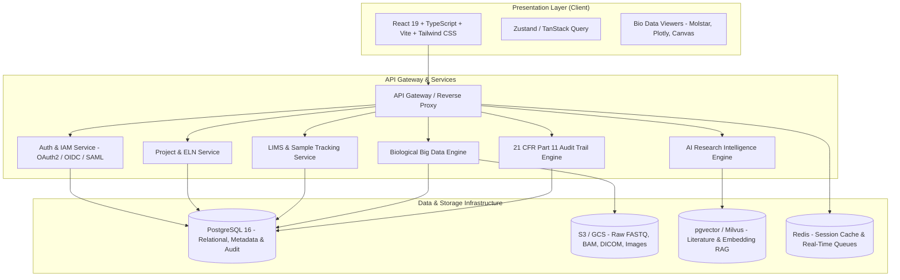

# Product Requirements Document (PRD)
## GatsBio — Unified Biotechnology Research, LIMS & Life Sciences Innovation Platform

---

| **Document Version** | 1.0.0 |
| :--- | :--- |
| **Status** | Approved / Ready for Architecture & Engineering |
| **Author** | Product Strategy & Systems Architecture |
| **Target Platform** | Web (Desktop-first Responsive), Tablet / Touchscreen Lab Stations |
| **Last Updated** | November 2026 |

---

## 1. Executive Summary & Overview

### 1.1 Product Description
**GatsBio** is an enterprise-grade digital ecosystem tailored for biotechnology companies, life sciences research institutes, clinical laboratories, and academic universities. By converging **Research Project Management**, **Laboratory Information Management Systems (LIMS)**, **Biological Big Data Repositories**, **Regulatory & Compliance Tracking (FDA/GMP/ISO)**, and an **AI Scientific Intelligence Engine** into a single cohesive interface, GatsBio eliminates fragmented lab notebooks, spreadsheet silos, and disconnected data chains.

### 1.2 Core Value Proposition
- **Accelerated Discovery Cycles**: Shortens research timelines by integrating AI-assisted literature synthesis, experimental protocol templating, and real-time data processing.
- **Flawless Chain of Custody & Traceability**: Barcode-driven sample tracking with automated immutable audit trails compliant with FDA 21 CFR Part 11.
- **Interoperable Biological Data Storage**: Native support for genomic, clinical, phenotypic, and instrument raw data formats with automated metadata tagging and version control.
- **Cross-Institutional Collaboration**: Granular multi-tenant workspaces, peer-review channels, IP ownership tracking, and publication pipelines.
- **Audit-Ready Compliance by Design**: Built-in GMP, GLP, ISO 17025, ISO 9001, and HIPAA compliance management.

---

## 2. Product Objectives & KPIs

| Objective | Target Metric / KPI | Validation Method |
| :--- | :--- | :--- |
| **Sample Throughput & Accuracy** | Reduce sample logging time by 60%; 0% lost specimen incidents | Barcode scan logs, chain-of-custody audits |
| **Research Project Velocity** | Reduce milestone turnaround by 25% | Project lifecycle analytics |
| **Regulatory Audit Readiness** | 100% electronic signature and audit log coverage | 21 CFR Part 11 compliance export reports |
| **AI Adoption & Utility** | >70% of researchers actively using AI hypothesis & literature tools | Monthly active usage (MAU) of AI Assistant |
| **Instrument Utilization** | Increase laboratory equipment uptime by 30% | Equipment reservation and maintenance logs |

---

## 3. User Personas & Core Workflows

### 3.1 Personas Matrix

| Role | Key Responsibilities | Primary Needs |
| :--- | :--- | :--- |
| **Research Scientist (PI / Postdoc)** | Designs hypotheses, runs assays, interprets results, writes papers. | Intuitive protocol designer, biological data viewers, AI synthesis, collaboration tools. |
| **Laboratory Technician** | Accessions samples, runs test batches, logs instrument runs, calibrates tools. | Fast barcode scanning, bulk entry, clear workflow pipelines, instrument logs. |
| **Clinical Research Coordinator** | Recruits trial subjects, oversees protocols, monitors adverse events. | Participant tracking, consent vaults, double-blind workflows, adverse event reports. |
| **Biotech Executive / Admin** | Manages departmental budgets, headcount, IP pipelines, organizational KPIs. | Executive dashboards, grant utilization, milestone tracking, IP portfolio visibility. |
| **Regulatory / QA Officer** | Validates SOPs, reviews deviation logs, signs off on batch records, audits trails. | Immutable logs, e-signatures (21 CFR Part 11), CAPA workflows, report generation. |
| **System Administrator** | Manages SSO, IAM roles, data retention policies, multi-tenancy, integrations. | Central RBAC/ABAC matrix, audit access logs, SSO/SAML, REST/GraphQL APIs. |

### 3.2 User Journeys & End-to-End Flows

```mermaid
flowchart TD
    subgraph ScientistFlow["3.2.1 Research Scientist Flow"]
        S1[Sign In via SSO] --> S2[Create Research Project & Milestones]
        S2 --> S3[Design Experiment Protocol]
        S3 --> S4[Request Lab Samples & Tests]
        S4 --> S5[Analyze Raw Biological Data & Run AI Engine]
        S5 --> S6[Collaborate & Peer Review Findings]
        S6 --> S7[Draft Journal Paper & File IP Record]
    end

    subgraph TechFlow["3.2.2 Lab Technician Flow"]
        T1[Sign In] --> T2[Scan Sample Barcode / Accession Specimen]
        T2 --> T3[Queue Test Workflow & Reserve Instrument]
        T3 --> T4[Execute Test & Record Raw Metrics]
        T4 --> T5[Upload Results & Flag Deviations]
        T5 --> T6[Log Instrument Maintenance & Cleaning]
    end

    subgraph ClinicalFlow["3.2.3 Clinical Coordinator Flow"]
        C1[Sign In] --> C2[Set Up Clinical Trial Protocol]
        C2 --> C3[Enroll Participants & Capture Informed Consent]
        C3 --> C4[Track Cohorts & Visit Schedules]
        C4 --> C5[Record Adverse Events & Blinded Observations]
        C5 --> C6[Export Regulatory Package for Institutional Review]
    end
```



---

## 4. Detailed Functional Requirements

### Module 2.1: User Authentication & Researcher Profiles
- **Authentication**:
  - Secure email/password with NIST-compliant password policies.
  - Social / Academic SSO: Google Workspace, Microsoft Azure AD / Entra ID, ORCID, InCommon / eduGAIN federated SSO.
  - Multi-Factor Authentication (MFA/2FA): Time-based One-Time Password (TOTP, e.g., Google Authenticator, Authy), FIDO2/WebAuthn hardware security keys, SMS backup.
- **Researcher Profiles & Scientific Identity**:
  - Academic & institutional credentials (ORCID iD, Scopus Author ID, PubMed affiliation).
  - Degree records, field of expertise tags (e.g., *Proteomics, CRISPR/Cas9, Oncology, Epigenetics*).
  - Bio, verified publication listing, and h-index/citation synching.
- **Multi-Organization & RBAC**:
  - Multi-tenancy: Users can belong to multiple organizations (e.g., Biotech Spinout + University Hospital).
  - Granular Role-Based Access Control (RBAC) and Attribute-Based Access Control (ABAC): *Owner, Admin, Principal Investigator (PI), Senior Scientist, Research Associate, Lab Tech, Clinical Coordinator, Auditor, Guest Collaborator*.

### Module 2.2: Research Project Management
- **Project Lifecycle Management**:
  - Project creation wizard: Project Charter, Hypotheses, Grant/Funding Code, Principal Investigator, Team Rosters, Target Milestones, and Gantt charts.
  - Milestone and experiment timeline tracking with dependencies (Finish-to-Start, Start-to-Start).
- **Task & Experiment Management**:
  - Kanban and List views for experiments with custom states (*Draft, In Review, In Progress, Blocked, Completed, Archived*).
  - Protocol templating with version-controlled standard operating procedures (SOPs).
- **Budget & Resource Allocation**:
  - Grant spending tracking, reagent burn rates, instrument hour billing, and vendor purchase requisitions.
- **Documentation & Electronic Lab Notebook (ELN)**:
  - Rich text, LaTeX math rendering, inline chemical formulas (ChemDoodle/SMILES), interactive molecular structures (PDB/Molstar viewer), and file attachments.

### Module 2.3: Laboratory Information Management System (LIMS)
- **Sample Accessioning & Barcode Generation**:
  - Specimen types: Tissue, Blood, Serum, DNA/RNA, Cell Lines, Plasmids, Reagents, Synthetics.
  - Barcode & QR Code Engine: Code 128, DataMatrix 2D, QR code generation and direct thermal label printer integration (Zebra ZPL, Brady).
  - Hierarchical Storage Location Management: Multi-facility $\rightarrow$ Freezers (-80°C, -20°C, Cryo tanks) $\rightarrow$ Shelves $\rightarrow$ Racks $\rightarrow$ 96/384 Well Plates $\rightarrow$ Specific Well coordinates $(A1 - H12)$.
- **Testing & Workflow Automation**:
  - Configurable assay pipelines: PCR, Next-Gen Sequencing (NGS), Western Blot, Flow Cytometry, ELISA, Mass Spectrometry.
  - Step-by-step technician execution runs with real-time parameter validation and checklist sign-offs.
- **Chain of Custody & Audit Trail**:
  - Strict sample custody logging: Who checked out, time, purpose, aliquot volume consumed, remaining freeze-thaw cycles, return location, disposal timestamp.

### Module 2.4: Biological Data Management
- **Centralized Scientific Data Repository**:
  - Genomic & Sequencing data management: Direct indexing and cloud storage streaming for FASTQ, FASTA, BAM, CRAM, VCF.
  - Clinical & Imaging data: DICOM, TIFF, FCS (Flow Cytometry Standard), PDB.
  - Tabular & Assay outputs: CSV, TSV, HDF5, AnnData (scRNA-seq).
- **Metadata Tagging & Ontologies**:
  - Automated extraction of biological metadata conforming to open biomedical ontologies (OBO Foundry, NCBI Taxonomy, Gene Ontology, MeSH).
- **Versioning & Provenance**:
  - Git-like biological dataset versioning ($v1.0.0 \rightarrow v1.0.1$) with diff tracking for processed tabular datasets and bioinformatic pipelines.

### Module 2.5: AI Research Intelligence Engine
- **Literature Mining & Knowledge Synthesis**:
  - Retrieval-Augmented Generation (RAG) powered by PubMed Central, bioRxiv, medRxiv, and IEEE Life Sciences APIs.
  - Natural language querying across millions of papers and institutional historical notebooks.
- **Drug Discovery & Molecular Insights**:
  - Target-ligand interaction summaries, known drug interaction alerts, and patent expiration timelines.
- **Hypothesis Generation & Gap Identification**:
  - Automated clustering of experimental anomalies to suggest follow-up assay designs.
  - Identification of under-explored protein-protein interactions or gene pathways.
- **AI Lab Assistant**:
  - Prompt-driven protocol optimization: *"Calculate serial dilution for 10 mM stock to 50 nM across 8 wells in triplicate."*

### Module 2.6: Laboratory Equipment Management
- **Equipment Inventory & Smart Monitoring**:
  - Asset cataloging: Centrifuges, Sequencers (Illumina/PacBio), Autoclaves, HPLC, Biosafety Cabinets, Incubators.
  - Spec sheets, warranty contracts, vendor emergency contact info.
- **Scheduling & Booking Engine**:
  - Visual calendar for booking instrument slots with anti-collision scheduling.
  - Tiered booking rights (priority given to mission-critical trial runs).
- **Calibration, Maintenance & IoT Integration**:
  - Scheduled maintenance alarms, calibration drift logging, and tolerance limits.
  - IoT telemetry ingestion (MQTT/HTTP) for real-time temperature, humidity, and CO₂ monitoring with SMS/email threshold alerts.

### Module 2.7: Clinical Trial Management
- **Trial Setup & Cohort Design**:
  - Multi-phase clinical trial management (Phase I - IV, Observational, Retrospective).
  - Inclusion/exclusion criteria filters, cohort arm definition (Placebo vs. Treatment A/B), and randomization blinding.
- **Participant & Consent Management**:
  - Electronic Informed Consent (e-Consent) with biometric/cryptographic digital signatures.
  - Longitudinal visit schedules, dosage logging, and automated patient appointment reminders.
- **Adverse Event (AE) & Safety Reporting**:
  - Standardized MedDRA coding for adverse events and serious adverse events (SAEs).
  - Automated trigger of regulatory notification drafts upon SAE detection within required statutory windows (e.g., 24-48 hours).

### Module 2.8: Scientific Collaboration Platform
- **Team Workspaces & Channels**:
  - Inter-departmental and cross-institutional project channels with instant messaging, threaded scientific debates, and emoji reactions.
  - Inline code, protocol snippet, and data plot sharing.
- **Document Co-authoring & Live Annotations**:
  - Real-time collaborative markdown/document editor with comment pins on microscopy images and data graphs.
- **Video & Audio Huddles**:
  - WebRTC-powered high-definition scientific screen-sharing (supporting multi-gigapixel slide views and 3D molecular representations).

### Module 2.9: Publication & Intellectual Property (IP) Management
- **Publication Lifecycle Tracking**:
  - Manuscript drafting $\rightarrow$ Internal IP sign-off $\rightarrow$ Journal submission tracking (Nature, Science, Cell, PLOS) $\rightarrow$ Peer-review revision cycles $\rightarrow$ DOI assignment.
- **Patent & IP Ownership Registry**:
  - Prior art search notes, inventor contribution percentages, formal invention disclosure forms (IDF), filing deadlines, and patent office correspondence (USPTO, EPO, WIPO).
- **Citation & Impact Analytics**:
  - Real-time citation metric tracking and altmetric attention scores for published artifacts.

### Module 2.10: Compliance & Regulatory Management
- **FDA 21 CFR Part 11 Compliance**:
  - Cryptographic dual-credential electronic signatures ("I approve this record" / "I have verified this assay").
  - System-generated, time-stamped, unalterable audit trails capturing every record create, update, read, and delete (CRUD).
- **Good Manufacturing Practice (GMP) & ISO 17025 / 9001**:
  - Corrective and Preventive Actions (CAPA) tracking.
  - Standard Operating Procedure (SOP) version control with mandatory read-and-understood employee attestations.
  - Out of Specification (OOS) investigation workflows.

### Module 2.11: Analytics & Research Intelligence Dashboard
- **Executive & Operational Dashboards**:
  - Real-time laboratory workload, open test queue depth, sample turnaround time (TAT).
  - Budget burndown vs. milestone achievement rates.
- **Interactive Visualizations**:
  - High-performance web canvas charts: Volcano plots, PCA clusters, Kaplan-Meier survival curves, heatmap matrices, and equipment utilization gauges.
- **Custom Report Builder & Scheduled Export**:
  - PDF, XLSX, and CSV automated report distribution to department heads and regulatory liaisons.

### Module 2.12: Admin & Organization Management
- **Enterprise IAM & Tenant Configuration**:
  - Multi-tenant partitioning with dedicated encryption keys (BYOK - Bring Your Own Key option).
  - Session timeouts, IP whitelisting for laboratory on-premise networks.
- **Billing & Subscription Management**:
  - Tiered licensing (Academic, Growth Biotech, Enterprise Pharma) with seat and cloud storage metering.

---

## 5. UI/UX Design System & Theme Specifications

### 5.1 Design Philosophy
Scientific rigor meets modern enterprise ergonomics. The interface prioritizes high information density without visual clutter, optimal contrast for lab environments under varying lighting, and rapid keyboard-first workflows (e.g., global command palette `Ctrl + K`).

### 5.2 Color Palette

```
Primary:         #1E40AF (Deep Blue - Trust, Authority, Scientific Precision)
Secondary:       #0F766E (Teal - Bio-Innovation, Data, Clinical Clarity)
Accent:          #10B981 (Emerald Green - Active Status, Passing QC, Verified)
Warning:         #F59E0B (Amber - Calibration Due, Pending Approval)
Destructive:     #EF4444 (Crimson - Contamination, OOS, SAE Alert)
Background:      #FFFFFF (Clean Lab White)
Surface / Muted: #F8FAFC (Slate Cool 50 - Card & Panel Backgrounds)
Border:          #E2E8F0 (Subtle Slate 200)
Text Primary:    #0F172A (Slate 900 - High Contrast Readability)
Text Muted:      #64748B (Slate 500)
```

### 5.3 Typography & Component System
- **Font Stack**:
  - Interface: `Inter, -apple-system, BlinkMacSystemFont, "Segoe UI", Roboto, sans-serif`
  - Code & Sequence Viewers: `JetBrains Mono, Fira Code, monospace`
- **Key Scientific Components**:
  - **96/384-Well Plate Interactive Grid**: Click, drag-to-select, multi-well aliquot assignment, color-coded concentration maps.
  - **DNA/RNA Sequence Ribbon**: Interactive nucleotide visualizer with highlightable reading frames and restriction enzyme cut sites.
  - **Sample Barcode Badge**: Visual representation of 1D/2D barcodes with quick copy, reprint, and scan trigger.
  - **Audit Trail Inspector**: Immutable sliding panel showing exact record history, timestamps, user ID, and cryptographic hashes.

---

## 6. Technical Architecture & Non-Functional Requirements

### 6.1 Proposed Architecture Diagram



### 6.2 Non-Functional Requirements (NFRs)

| Dimension | Specification |
| :--- | :--- |
| **Security & Privacy** | AES-256 encryption at rest; TLS 1.3 in transit. End-to-end audit logging. HIPAA Business Associate Agreement (BAA) ready. |
| **Regulatory Compliance** | FDA 21 CFR Part 11 (Audit trails, dual-factor e-signatures, password expiration). EU Annex 11, GAMP 5 validation methodology. |
| **Performance & Latency**| Web interface initial load < 1.2s; LIMS sample scan response < 200ms; Plate visualizer (384 wells) render time < 50ms at 60 FPS. |
| **Scalability** | Capable of storing >10 million sample records and petabyte-scale biological object references per tenant. |
| **Availability & DR** | 99.95% uptime SLA; Cross-region automated daily backups with RPO < 15 minutes, RTO < 2 hours. |
| **Accessibility** | WCAG 2.1 Level AA compliance across all primary researcher and technician workflows. |

---

## 7. Future Enhancements & Strategic Roadmap

### Phase 1: MVP & Core Operations (Months 1–4)
- User Authentication, RBAC, Multi-Org structure.
- Core LIMS (Sample accessioning, barcode generation, 96-well plate mapping).
- Research Project Management & Electronic Lab Notebook basics.
- FDA 21 CFR Part 11 basic immutable audit trail & e-signatures.

### Phase 2: Biological Data, Analytics & Clinical (Months 5–8)
- Biological Data Management (FASTQ/BAM ingestion, metadata extraction).
- Laboratory Equipment Management & Booking calendar.
- Clinical Trial Management (Protocols, consent, participant tracking).
- Advanced Analytics Dashboard (TAT, utilization, grant burndown).

### Phase 3: AI Engine & Advanced Ecosystem (Months 9–12)
- AI Research Intelligence Engine (PubMed/bioRxiv RAG, hypothesis generation).
- IoT-connected smart laboratory incubators and freezer sensor feeds.
- Protein structure integration (AlphaFold/ESMFold predictions via Molstar).
- Global Research Collaboration Hub & IP/Publication management suite.

---

## 8. Acceptance Criteria & Sign-Off Checklist

- [ ] **Auth**: Users can sign in via email or SAML SSO, enable 2FA, and belong to multiple research institutions.
- [ ] **LIMS**: Technician can generate a unique 2D barcode, place a sample into a freezer shelf/plate, and scan it back with 100% fidelity.
- [ ] **Audit Trail**: Every modification to sample state or protocol creates an uneditable, cryptographically signed log entry.
- [ ] **AI Assistant**: Natural language query against indexed papers yields verified citations with direct DOI references.
- [ ] **Regulatory**: Exportable audit log package passes mock 21 CFR Part 11 inspection checklist.
