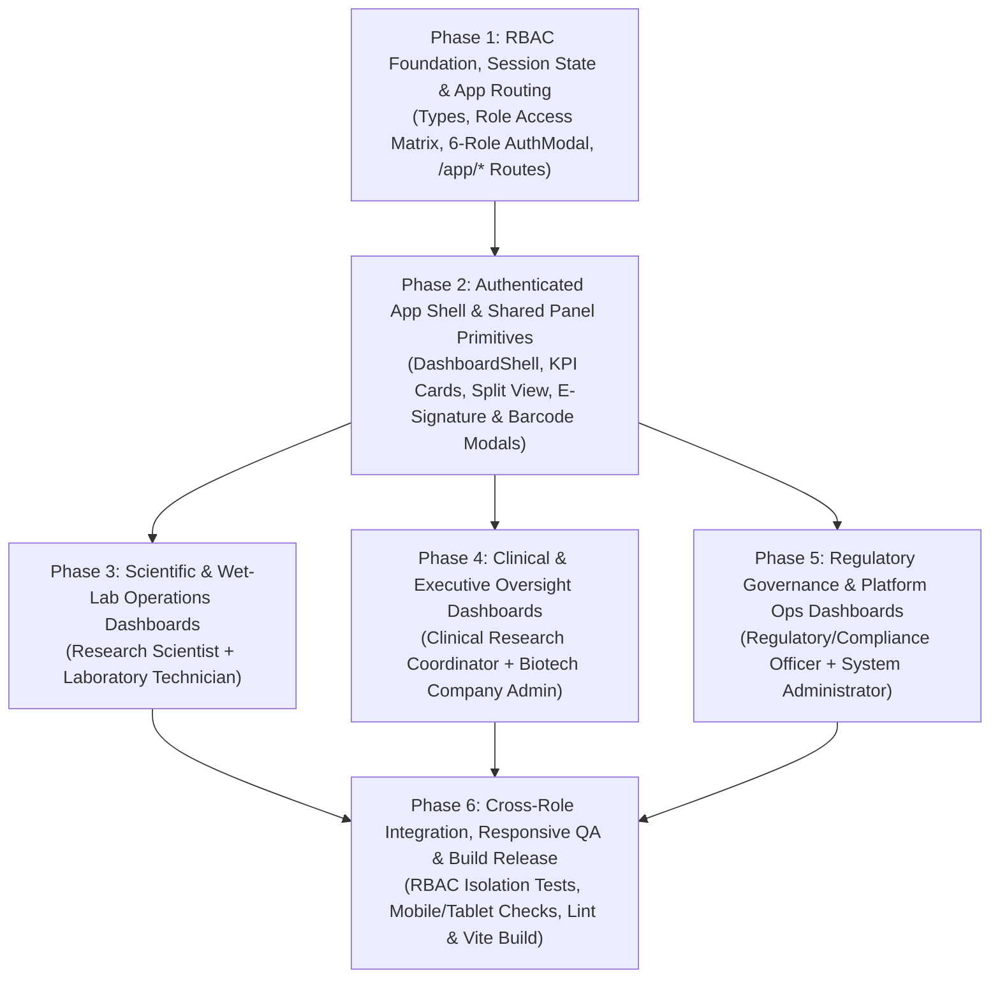

# GatsBio — Phased Implementation Plan for Role-Based Dashboard Panels

| **Document Version** | 2.0.0 (Phase-by-Phase Execution Plan) |
| :--- | :--- |
| **Target Codebase** | `d:\MVP\GatesBio` (`React 19`, `TypeScript`, `Vite`, `@mui/material`, `@mui/icons-material`, `recharts`, `jsbarcode`, `qrcode.react`, `framer-motion`) |
| **Associated Docs** | [`PRD.md`](file:///d:/MVP/GatesBio/PRD.md), [`design.md`](file:///d:/MVP/GatesBio/design.md), [`IMPLEMENTATION_PLAN.md`](file:///d:/MVP/GatesBio/IMPLEMENTATION_PLAN.md) |
| **Theme Tokens** | Primary `#1E40AF`, Secondary `#0F766E`, Success `#10B981`, Warning `#F59E0B`, Critical `#DC2626`, Dark Navy `#0F172A`, Surface `#F8FAFC` |

---

## Overview & Phase Dependency Flow



---

## Phase 1: RBAC Foundation, Session State & App Routing

### Goal
Establish strict TypeScript domain types, centralized role-based access rules, 6-role login support, and `/app/*` routing without disrupting the existing public website.

### Files to Create / Update
- **Create `src/types/dashboard.ts`**:
  - Define `UserRoleId`: `'research-scientist' | 'lab-technician' | 'clinical-coordinator' | 'biotech-admin' | 'compliance-officer' | 'system-admin'`.
  - Define `DashboardSession` (`userName`, `email`, `roleId`, `roleTitle`, `organization`, `department`, `mfaVerified`).
  - Define role panel data interfaces (`ResearchProjectItem`, `ExperimentRun`, `LabTestTask`, `ClinicalTrialItem`, `AdverseEventItem`, `BudgetAllocation`, `CapaDeviationItem`, `OrgUserRecord`, `SystemServiceHealth`).
- **Create `src/config/roleAccess.ts`**:
  - Map each `UserRoleId` to its route path (`/app/scientist`, `/app/technician`, `/app/clinical`, `/app/biotech-admin`, `/app/compliance`, `/app/system-admin`), accent color, sidebar nav items, and permitted modules (`2.1`–`2.12`).
- **Update `src/types/index.ts` & `src/App.tsx`**:
  - Add `/app/*` routes to `ROUTE_PATHS`, store `activeSession` state, and route authenticated users into the dashboard shell while hiding `PublicNavbar` and `PublicFooter`.
- **Update `src/components/public/AuthModal.tsx`**:
  - Expand the 3 sandbox persona cards to all **6 user roles** (`4.1`–`4.6`) and pass the selected role into `onLoginSuccess`.

### Phase 1 Acceptance Criteria
- [ ] Selecting any of the 6 roles in `AuthModal` navigates to its corresponding `/app/*` route.
- [ ] Direct URL navigation (`window.location.pathname`) and browser Back/Forward (`popstate`) work for all 6 dashboard routes.
- [ ] Public routes (`/`, `/platform`, `/tailored-solutions`, `/resources`, `/compliance`, `/pricing`, `/tools`) continue working unchanged.

---

## Phase 2: Authenticated App Shell & Shared Panel Primitives

### Goal
Build the shared workstation shell from [`design.md`](file:///d:/MVP/GatesBio/design.md) and reusable UI components so all 6 role dashboards share consistent typography, density, and defensive controls.

### Files to Create
- **Create `src/components/app/DashboardShell.tsx`**:
  - **Top Bar (`64px`)**: Brand mark, collapsible sidebar toggle, global search bar (`Ctrl+K`), organization switcher (`2.1`), live notifications popover, quick **Role Switcher** dropdown, and `"Back to Public Site / Sign Out"` button.
  - **Role-Filtered Left Sidebar**: `240px` expanded / `64px` collapsed on desktop; slide-over `Drawer` on mobile/tablet; dynamically filters nav links from `ROLE_CONFIGS[session.roleId]`.
- **Create `src/components/app/shared/`**:
  - `KpiStatCard.tsx`: `tabular-nums` KPI metric card with delta chip and icon badge.
  - `DashboardSectionHeader.tsx`: Standardized header with filter controls and primary CTA.
  - `StatusChip.tsx`: Semantic color mapping (`Pass/Operational` `#10B981`, `Pending/Due` `#F59E0B`, `Critical/OOS` `#DC2626`, `Active` `#1E40AF`).
  - `WorkstationSplitView.tsx`: Responsive 65%/35% split workspace that stacks cleanly on mobile/tablet.
  - `ESignatureModal.tsx`: Reusable 21 CFR Part 11 dual-credential challenge + signature meaning + SHA-256 checksum preview.
  - `BarcodeLabelModal.tsx`: Reusable 1D Code 128 (`jsbarcode`) + 2D QR (`qrcode.react`) thermal label preview dialog.
- **Create `src/data/roleDashboardData.ts`**:
  - Seed structured operational datasets for projects, LIMS samples, trials, budgets, CAPA/SOPs, and IAM users.

### Phase 2 Acceptance Criteria
- [ ] Sidebar updates dynamically when switching between roles.
- [ ] `DashboardShell` collapses/expands cleanly on desktop and opens via drawer on mobile (`xs`/`sm`).
- [ ] Shared modals (`ESignatureModal`, `BarcodeLabelModal`) render crisply without layout overflow.

---

## Phase 3: Scientific & Wet-Lab Operations Dashboards

### Goal
Deliver the daily-driver dashboards for bench scientists and laboratory technicians (`4.1` & `4.2`).

### Role 1: Research Scientist Dashboard (`src/pages/app/ResearchScientistDashboard.tsx`)
- **Modules Covered:** `2.1`, `2.2`, `2.3`, `2.4`, `2.5`, `2.8`, `2.9`, `2.11`
- **Panels:**
  1. **KPI Row:** Active Research Projects, Experiments Running, Pending Peer Reviews, Publications & Patents.
  2. **Projects & Milestones (`2.2`):** Project table/cards with milestone progress bars, grant codes, and `"New Project"` drawer.
  3. **Experiment & ELN Split Workspace (`2.2`, `2.3`):** Interactive SOP step checklist paired with linked sample aliquots and observation notes.
  4. **AI Research Intelligence Panel (`2.5`):** Literature query bar, hypothesis recommendations, drug interaction alerts, and research gap cards.
  5. **Datasets, Collaboration & IP (`2.4`, `2.8`, `2.9`):** Versioned datasets (`FASTQ`, `BAM`, `VCF`), team discussion feed, and publication/patent status tracker.

### Role 2: Laboratory Technician Dashboard (`src/pages/app/LabTechnicianDashboard.tsx`)
- **Modules Covered:** `2.1`, `2.2` (tasks), `2.3`, `2.4` (uploads), `2.6`
- **Panels:**
  1. **KPI Row:** Samples Accessioned Today, Queued Lab Tests, Equipment Ready vs. Calibration Due, Cryo Storage Capacity %.
  2. **Sample Accessioning & Barcode Queue (`2.3`):** Specimen registration form + `BarcodeLabelModal` trigger for 1D/2D labels.
  3. **96-Well Microplate & Assay Queue (`2.3`):** Interactive 8×12 well grid for sample assignment, concentration heatmaps, and result upload.
  4. **Cryogenic Freezer Hierarchy & Chain of Custody (`2.3`, `2.4`):** `Freezer → Shelf → Rack → Box` selector with freeze-thaw cycle warnings and custody check-in/out.
  5. **Equipment Booking & IoT Telemetry (`2.6`):** Instrument reservation schedule, calibration log modal, and `recharts` live temp/CO₂ trend chart.

### Phase 3 Acceptance Criteria
- [ ] Research Scientists can create projects, toggle ELN steps, and query AI literature insights.
- [ ] Lab Technicians can register samples, preview barcodes, inspect 96-well coordinates, and view live equipment telemetry.

---

## Phase 4: Clinical & Executive Oversight Dashboards

### Goal
Deliver clinical trial orchestration and executive portfolio/budget analytics dashboards (`4.3` & `4.4`).

### Role 3: Clinical Research Coordinator Dashboard (`src/pages/app/ClinicalCoordinatorDashboard.tsx`)
- **Modules Covered:** `2.1`, `2.3` (custody), `2.4` (clinical), `2.7`, `2.8`, `2.10`
- **Panels:**
  1. **KPI Row:** Active Trials (Phase I–IV), Enrolled Participants vs. Target, Pending e-Consents, Open Adverse Events.
  2. **Clinical Trial Setup & Cohort Progress (`2.7`):** Trial cards with randomization arms (Placebo vs. Treatment), enrollment chart (`recharts`), and `"New Trial"` drawer.
  3. **Participant Recruitment & Consent Vault (`2.7`):** De-identified participant tracker (`SUBJ-XXXX`), visit schedule adherence, and informed consent status.
  4. **Blinded Biospecimen Chain-of-Custody (`2.3`, `2.4`):** Links participant visit draws to barcoded blood/tissue vials with double-blind masking.
  5. **Adverse Event & Regulatory Reporting (`2.7`, `2.10`):** MedDRA-coded adverse event log + IRB/regulatory submission export preview.

### Role 4: Biotech Company Administrator Dashboard (`src/pages/app/BiotechAdminDashboard.tsx`)
- **Modules Covered:** `2.1`, `2.2`, `2.6` (utilization), `2.9`, `2.10`, `2.11`, `2.12` (org)
- **Panels:**
  1. **KPI Row:** Total Research Headcount, On-Time Milestones %, Quarterly R&D Budget Burn, Compliance Readiness %.
  2. **Portfolio & Milestone Health Matrix (`2.2`, `2.11`):** Cross-department project overview with PI owners, timelines, and risk flags.
  3. **Funding & Reagent Budget Analytics (`2.2`, `2.11`):** `recharts` stacked chart comparing grant/department allocations against reagent & equipment burn.
  4. **Lab Utilization & Productivity Reports (`2.6`, `2.11`):** Equipment utilization metrics + AI executive bottleneck summary.
  5. **Team Roster, IP & Compliance Overview (`2.1`, `2.9`, `2.10`, `2.12`):** Department headcount breakdown, patent filings, and compliance status.

### Phase 4 Acceptance Criteria
- [ ] Clinical Coordinators can track blinded cohorts, consents, adverse events, and specimen custody.
- [ ] Biotech Admins can filter portfolio timelines and inspect interactive `recharts` budget and utilization charts.

---

## Phase 5: Regulatory Governance & Platform Operations Dashboards

### Goal
Deliver compliance auditing, electronic signature approval workflows, and platform security/IAM controls (`4.5` & `4.6`).

### Role 5: Regulatory & Compliance Officer Dashboard (`src/pages/app/ComplianceOfficerDashboard.tsx`)
- **Modules Covered:** `2.1`, `2.3` (audit), `2.4` (provenance), `2.7` (audit), `2.9` (IP), `2.10`, `2.11`
- **Panels:**
  1. **KPI Row:** Audit Readiness Score, Pending 21 CFR Part 11 Sign-Offs, Open CAPA/Deviations, Overdue Calibrations.
  2. **Pending E-Signature Approval Queue (`2.10`):** Protocol releases and batch records awaiting approval, wired to `<ESignatureModal />` with SHA-256 seal generation.
  3. **Immutable Audit Trail & Custody Inspector (`2.3`, `2.10`):** Searchable, filterable event ledger (filter by operator, action `CREATE/UPDATE/SIGN`, entity ID) with CSV/PDF export.
  4. **Controlled SOP & Regulatory Registry (`2.10`):** Versioned SOP table mapped to FDA, GMP, and ISO 17025 review cycles.
  5. **CAPA, Calibration & Trial Audit Monitor (`2.6`, `2.7`, `2.10`):** Tracks out-of-spec runs, calibration expirations, and clinical regulatory submissions.

### Role 6: System Administrator Dashboard (`src/pages/app/SystemAdminDashboard.tsx`)
- **Modules Covered:** `2.1`, `2.4` (storage), `2.6` (IoT infra), `2.10` (retention), `2.12`
- **Panels:**
  1. **KPI Row:** Active Users & Organizations, 2FA/SSO Adoption %, Platform Uptime & API Health, Bio Data Lake Storage Used.
  2. **User, Organization & RBAC Policy Matrix (`2.1`, `2.12`):** Interactive user directory with role dropdowns, multi-org tags, and invite/suspend controls.
  3. **SSO, 2FA & Security Configuration (`2.1`, `2.12`):** Toggles for SAML/OIDC SSO (Google Workspace, Entra ID, ORCID), mandatory 2FA/FIDO2, password aging, and session timeouts.
  4. **Infrastructure, Storage & IoT Gateways (`2.4`, `2.6`, `2.12`):** `recharts` API/storage telemetry chart + live IoT sensor gateway status cards.
  5. **Subscription & System Operations (`2.12`):** Seat license utilization meter, backup/replication status, and system security logs.

### Phase 5 Acceptance Criteria
- [ ] Compliance Officers can execute a simulated dual-key e-signature that appends a sealed entry to the audit ledger.
- [ ] System Admins can modify user RBAC roles, toggle SSO/2FA security policies, and inspect infrastructure telemetry.

---

## Phase 6: Cross-Role Integration, Responsive QA & Build Release

### Goal
Verify end-to-end navigation, RBAC isolation, responsive mobile/tablet/desktop behavior, TypeScript strictness, and production build integrity.

### Tasks
1. **Cross-Role Workflow Checks:**
   - Verify a sample registered in Lab Technician (`4.2`) or a protocol submitted by Research Scientist (`4.1`) reflects cleanly in Compliance Officer (`4.5`) audit/sign-off queues via shared state or synchronized mock store.
2. **Responsive Breakpoint Audit:**
   - Test all 6 dashboards across `xs` (375px), `sm`/`md` (768px–1024px), and `lg`/`xl` (1440px+) viewports with zero horizontal scrollbars.
3. **Static & Build Verification:**
   - Run `npm run build` (`tsc -b && vite build`) and `npm run lint` (`eslint .`) with exit code `0`.

---

## Target Directory Structure

```text
src/
├── config/
│   └── roleAccess.ts
├── data/
│   └── roleDashboardData.ts
├── types/
│   └── dashboard.ts
├── components/
│   └── app/
│       ├── DashboardShell.tsx
│       └── shared/
│           ├── BarcodeLabelModal.tsx
│           ├── DashboardSectionHeader.tsx
│           ├── ESignatureModal.tsx
│           ├── KpiStatCard.tsx
│           ├── StatusChip.tsx
│           └── WorkstationSplitView.tsx
└── pages/
    └── app/
        ├── BiotechAdminDashboard.tsx
        ├── ClinicalCoordinatorDashboard.tsx
        ├── ComplianceOfficerDashboard.tsx
        ├── LabTechnicianDashboard.tsx
        ├── ResearchScientistDashboard.tsx
        └── SystemAdminDashboard.tsx
```
