# GatsBio Design System & UI/UX Technical Architecture
## Enterprise Life Sciences & Biotechnology Platform

---

| **Document Version** | 1.0.0 |
| :--- | :--- |
| **Status** | Approved Specification |
| **Associated PRD** | [`PRD.md`](file:///d:/MVP/GatesBio/PRD.md) |
| **Tech Stack Target**| React 19, TypeScript, Vite, Tailwind CSS, Lucide Icons, Canvas/WebGL |
| **Target Viewports** | High-Res Laboratory Workstations (1920x1080+), Laptops (1440x900), Lab Tablets (1024x768) |

---

## 1. Design Vision & Philosophy

GatsBio operates at the intersection of **clinical precision, biological big data, and high-velocity laboratory workflows**. Unlike generic SaaS platforms, a biotech platform demands:

1. **Extreme Information Density with Visual Hierarchy**: Scientists and technicians process hundreds of wells, data points, and metadata tags simultaneously without page fatigue.
2. **Defensive UI & Zero Ambiguity**: In life sciences, an accidental misclick can invalidate a month-long trial or compromise a bio-sample. Destructive actions, hazardous materials, and regulatory sign-offs require deliberate, multi-step verification.
3. **Lab-Ready Usability**: High-contrast modes, legible typography even at distance or under ambient lab lighting, and touch/glove-tolerant hit targets on benchtop tablets.
4. **Fluid Scientific Interaction**: Dedicated controls for 96/384-well plates, DNA sequences, flow cytometry scatter plots, and freezer hierarchy navigators.

---

## 2. Color System & Semantic Tokens

The color architecture is built around **Deep Blue** (scientific rigor and reliability), **Teal** (biological innovation and genomic data), and **Emerald** (verified quality control and passing results).

### 2.1 Color Palette Matrix

| Token Name | Hex Code | HSL | Contrast vs White | Semantic Purpose |
| :--- | :--- | :--- | :--- | :--- |
| `--color-primary-900` | `#0F172A` | `222, 47%, 11%` | 16.5:1 (AAA) | Deep Navy Text, App Shell headers |
| `--color-primary-700` | `#1E3A8A` | `224, 64%, 33%` | 8.9:1 (AAA) | Primary brand buttons, active navigation, links |
| `--color-primary-600` | `#1E40AF` | `224, 71%, 40%` | 7.1:1 (AAA) | **Primary Brand Color** (Brand accents, primary focus) |
| `--color-primary-100` | `#DBEAFE` | `214, 95%, 93%` | 1.2:1 | Selected row highlight, badge background |
| `--color-primary-50`  | `#EFF6FF` | `214, 100%, 97%`| 1.1:1 | Panel background tint, light hover states |
| `--color-secondary-800`| `#115E59` | `175, 69%, 22%`| 7.5:1 (AAA) | Secondary headings, lab equipment status |
| `--color-secondary-600`| `#0F766E` | `175, 77%, 26%`| 5.8:1 (AA) | **Secondary Brand Color** (Assays, LIMS tags) |
| `--color-secondary-100`| `#CCFBF1` | `167, 85%, 89%`| 1.3:1 | LIMS sample tags, protocol pills |
| `--color-accent-600`   | `#10B981` | `160, 84%, 39%`| 3.4:1 (UI AA)| **Success / Pass QC** (Valid sample, calibrated) |
| `--color-accent-50`    | `#ECFDF5` | `152, 81%, 96%`| 1.1:1 | QC Passed table cells, verified badges |
| `--color-warning-500`  | `#F59E0B` | `38, 92%, 50%` | 2.1:1 (Icons) | **Attention / Pending** (Calibration due, under review) |
| `--color-warning-50`   | `#FFFBEB` | `48, 100%, 96%`| 1.1:1 | Warning banner fill, pending review card |
| `--color-danger-600`   | `#DC2626` | `0, 72%, 51%`  | 4.6:1 (AA) | **Critical / Biohazard / OOS** (Deviation, out-of-spec) |
| `--color-danger-50`    | `#FEF2F2` | `0, 86%, 97%`  | 1.1:1 | Biohazard container alert, failed assay fill |

### 2.2 Neutral & Surface Hierarchy

```css
:root {
  --surface-base:        #FFFFFF; /* Pure Lab White */
  --surface-subtle:      #F8FAFC; /* Slate 50 - Card containers, sidebars */
  --surface-muted:       #F1F5F9; /* Slate 100 - Table header, plate empty well */
  --surface-elevated:    #FFFFFF; /* Modals, Dropdowns, Popovers (with shadow) */
  --border-subtle:       #E2E8F0; /* Slate 200 - Gridlines, dividers */
  --border-strong:       #CBD5E1; /* Slate 300 - Input borders, active outlines */
  --text-main:           #0F172A; /* Slate 900 - High contrast body & headers */
  --text-muted:          #64748B; /* Slate 500 - Meta info, unit labels, timestamps */
  --text-disabled:       #94A3B8; /* Slate 400 - Inactive wells, disabled actions */
}
```

### 2.3 Scientific Categorical Color Scheme
For multi-channel assays, chromosome mappings, and well-plate sample assignments:
- **DNA / RNA**: Cyan `#06B6D4`
- **Proteins / Antibodies**: Indigo `#6366F1`
- **Reagents / Buffers**: Amber `#F59E0B`
- **Positive Control**: Emerald `#10B981`
- **Negative Control / Blank**: Slate `#94A3B8`
- **Vehicle / Placebo**: Violet `#8B5CF6`

---

## 3. Typography & Numerical Formatting

Scientific workflows depend on micro-typography where digits and chemical symbols cannot be misread.

### 3.1 Font Stack
```css
/* General UI Font */
--font-sans: 'Inter', -apple-system, BlinkMacSystemFont, "Segoe UI", Roboto, sans-serif;

/* DNA/RNA, Protein Sequences, Code, Lab Instrument Hex Logs */
--font-mono: 'JetBrains Mono', 'Fira Code', ui-monospace, SFMono-Regular, monospace;
```

### 3.2 Type Scale

| Style Token | Size / Line-Height | Weight | Tracking | Usage |
| :--- | :--- | :--- | :--- | :--- |
| `text-display` | 32px / 40px | 700 Bold | -0.02em | Main Dashboard Title, High-level KPI values |
| `text-h1` | 24px / 32px | 700 Bold | -0.015em| Page Titles (e.g., "LIMS - Sample Accessioning") |
| `text-h2` | 20px / 28px | 600 SemiBold | -0.01em | Section Titles, Modal Headers, Plate IDs |
| `text-h3` | 16px / 24px | 600 SemiBold | -0.005em| Card Titles, Experiment Run Names |
| `text-body` | 14px / 20px | 400 Regular | normal | Default data tables, descriptions, form labels |
| `text-body-bold` | 14px / 20px | 600 SemiBold| normal | Sample IDs, active tab titles |
| `text-small` | 12px / 16px | 500 Medium | +0.01em | Badge text, well coordinates (A1-H12), timestamps |
| `text-mono-code` | 13px / 18px | 500 Medium | 0 | FASTA sequences, barcode text, JSON telemetry |

### 3.3 Numerical Rules
- All numeric tables use `font-variant-numeric: tabular-nums` to ensure exact column alignment for aliquots, volumes ($\mu\text{L}$), concentrations ($\text{ng}/\mu\text{L}$), and $p\text{-values}$.
- Standardized unit rendering with non-breaking spaces: `50.4 µL`, `37.0 °C`, `12,000 RPM`.

---

## 4. Layout Architecture & App Shell

### 4.1 Master App Shell Layout

```
+-----------------------------------------------------------------------------------------------------+
| [GatsBio Logo]   [Global Search Ctrl+K]               [Tenant: BioGenix Labs v] [Alerts (3)] [Profile] |
+------------------+----------------------------------------------------------------------------------+
| Navigation Bar   | Breadcrumb: Research > Projects > CRISPR-Cas9 Target Screen > Run #104           |
| (64px Collapsed/ |----------------------------------------------------------------------------------|
|  240px Expanded) | Action Toolbar: [+ Add Aliquot] [Import Run Data] [Batch Scan] [21 CFR Sign-Off] |
|                  +----------------------------------------------+-----------------------------------+
| * Dashboard      | Primary Work Area (65%)                      | Context Inspector (35%)           |
| * Projects & ELN | - Protocol Steps (Interactive Checklist)     | - Selected Well / Sample Details  |
| * LIMS Samples   | - 96-Well Microplate Visualizer              | - Chain of Custody & Temp Log    |
| * Bio Data Lake  |   (Live Heatmap: Concentration)              | - Instrument Calibration State    |
| * AI Engine      | - Real-time Assay Progress Telemetry         | - Attached Spectrophotometer Raw  |
| * Equipment      |                                              |   Curve Preview                   |
| * Trials (GCP)   |                                              |                                   |
| * Compliance     +----------------------------------------------+-----------------------------------+
| * Settings       | Bottom Dock: Console, Execution Logs, Queue (Minimizable, 32px collapsed)        |
+------------------+----------------------------------------------------------------------------------+
```

### 4.2 Split-Screen Workstation Design
Laboratory work frequently requires cross-referencing an Electronic Lab Notebook (ELN) protocol while examining live data feeds or 96-well layouts.
- **Left Pane (Default 60-70%)**: Interactive protocol runner, step execution, tabular sample entry.
- **Right Inspector (Default 30-40%)**: Contextual preview that dynamically updates based on the active selection (e.g., clicking well `C4` shows aliquot lineage, volume remaining, freeze-thaw cycles, and technician notes).
- **Draggable Splitter**: Allows power users to resize panes freely with persistence in `localStorage`.

---

## 5. Domain-Specific Scientific Component Library

### 5.1 Interactive Microplate Visualizer (`<WellPlateGrid />`)
Used in LIMS, Assay Execution, and PCR/ELISA preparation.

```
       1     2     3     4     5     6     7     8     9    10    11    12
   +-----+-----+-----+-----+-----+-----+-----+-----+-----+-----+-----+-----+
 A | [Pos] [Pos] [   ] [   ] [S01] [S02] [S03] [S04] [   ] [   ] [Neg] [Neg]
 B | [   ] [   ] [   ] [   ] [S05] [S06] [S07] [S08] [   ] [   ] [   ] [   ]
 C | [   ] [   ] [   ] [   ] [S09] [S10] [S11] [S12] [   ] [   ] [   ] [   ]
 D | [   ] [   ] [   ] [   ] [S13] [S14] [S15] [S16] [   ] [   ] [   ] [   ]
 E | ... (Rows A through H for 96-well, or A through P for 384-well)
```

- **Features**:
  - Multi-select drag box (marquee selection across blocks of wells).
  - Fill pattern modes: By Row ($A1 \rightarrow A12$), By Column ($A1 \rightarrow H1$), Checkerboard, or Custom Aliquot Matrix.
  - Heatmap gradient overlay: Visualizes sample volume or concentration ($0 - 100\,\text{ng}/\mu\text{L}$).
  - Well State Indicators: Empty (Dotted outline), Loaded (Filled color), Active Pipetting Target (Pulsing ring), Error/Contaminated (Red crosshatch).

### 5.2 DNA / RNA Sequence Ribbon (`<SequenceViewer />`)
- **Visual Display**: Monospace font with alternating base color accents:
  - Adenine (**A**): Green `#10B981`
  - Thymine / Uracil (**T / U**): Red `#EF4444`
  - Cytosine (**C**): Blue `#3B82F6`
  - Guanine (**G**): Yellow/Amber `#F59E0B`
- **Interactive Capabilities**:
  - Click-and-drag range selection showing base pair count, GC content percentage (%), and Melting Temperature ($T_m$).
  - Annotation track below sequence showing CDS, promoters, and restriction enzyme recognition sites (e.g., *EcoRI*, *BamHI*).

### 5.3 21 CFR Part 11 Electronic Signature Modal (`<ESignatureModal />`)
Regulatory compliance requires a two-factor electronic signature on critical transitions.

- **Visual Requirements**:
  - Distinct amber/blue regulatory banner with law reference badge: `FDA 21 CFR Part 11 Compliant`.
  - Display of exact record snapshot hash (`SHA-256: e3b0c44298fc1c149afbf4c8996fb92427ae41e4649b934ca495991b7852b855`).
  - Required fields:
    1. Signer Full Name (Pre-filled from authenticated session).
    2. Meaning of Signature (Dropdown: *Author / Creator*, *Technical Reviewer*, *QA Approval*, *Regulatory Release*).
    3. Re-authentication Password / TOTP Security Token.
  - Once signed, the UI displays an uneditable cryptographic stamp with a green verifiable badge.

### 5.4 Freezer Hierarchy Navigator (`<StorageTreeNavigator />`)
Visualizing cryogenic specimen storage:
- **Level 1**: Facility (e.g., *Cambridge Bld 3*)
- **Level 2**: Room / Cold Storage (*Cold Room 102B*)
- **Level 3**: Unit (*Ultra-Low -80°C Freezer #4*)
- **Level 4**: Shelf (*Shelf 2*)
- **Level 5**: Rack (*Rack B*)
- **Level 6**: Box (*9x9 Cryo Box "CRISPR-T1"*)
- **Level 7**: Coordinate Slot (*Slot D7*)

Each node shows current temperature status, capacity fullness bar (e.g., *64/81 used - 79%*), and alert badges.

### 5.5 Scientific Charting Engine (`<BioChartEngine />`)
Powered by lightweight HTML5 Canvas / WebGL for sub-millisecond rendering of dense datasets:
- **Volcano Plot**: Log2 Fold Change vs $-\log_{10}(p\text{-value})$ with interactive lasso selection of upregulated/downregulated genes.
- **Kaplan-Meier Survival Curves**: Clinical trial time-to-event curves with hazard ratios and confidence interval shading.
- **Flow Cytometry 2D Density Plot**: Forward Scatter (FSC) vs Side Scatter (SSC) with polygon gating tools.

---

## 6. Information Architecture & Route Hierarchy

```mermaid
graph TD
    App[GatsBio Platform] --> Auth[Auth & Onboarding]
    App --> Dashboard[Executive & Lab Dashboards]
    App --> Projects[Research Projects & ELN]
    App --> LIMS[LIMS & Sample Logistics]
    App --> BioData[Biological Data Lake]
    App --> AIResearch[AI Intelligence Engine]
    App --> Equipment[Equipment & IoT Telemetry]
    App --> Clinical[Clinical Trial Management]
    App --> Compliance[Regulatory & 21 CFR Part 11]
    App --> Admin[Organization & System Admin]

    Projects --> ProjectsList[Project Directory]
    Projects --> ProjectDetail[Project Workspace & Milestones]
    Projects --> ELNNotebook[Electronic Lab Notebook - ELN]

    LIMS --> SampleRegistry[Sample Accessioning & Barcodes]
    LIMS --> PlateManager[96/384-Well Plate Builder]
    LIMS --> FreezerStorage[Freezer & Storage Navigator]
    LIMS --> AssayQueue[Assay Execution Pipelines]

    BioData --> Genomes[Genomics - FASTQ/BAM/VCF]
    BioData --> Imaging[Microscopy & DICOM Viewer]
    BioData --> Datasets[Dataset Versioning & Provenance]

    Compliance --> AuditLogs[Immutable Audit Ledger]
    Compliance --> SOPs[SOP & Policy Management]
    Compliance --> CAPA[CAPA & Deviation Tracking]
```



### 6.1 Route Mapping Table

| Route Path | View Component | Key Purpose |
| :--- | :--- | :--- |
| `/` | `DashboardView` | Summary KPIs, urgent alerts, assigned tasks, equipment status |
| `/projects` | `ProjectListView` | Grid/List of research initiatives, grant codes, milestone progress |
| `/projects/:id` | `ProjectDetailView` | Project charter, Gantt timeline, experiment list, budget tracker |
| `/projects/:id/eln/:noteId` | `ELNEditorView` | Rich lab notebook with protocol checklists and molecular embedders |
| `/lims/samples` | `SampleRegistryView`| Sample directory, barcode generator, bulk accessioning wizard |
| `/lims/plates` | `PlateManagerView` | 96/384-well plate visualizer, liquid handler export |
| `/lims/storage` | `StorageHierarchyView`| Visual freezer, shelf, rack, and box coordinate explorer |
| `/lims/assays` | `AssayExecutionView`| Step-by-step test execution, technician checklist, result upload |
| `/bio-data` | `BioDataLakeView` | Genomic, proteomic, and imaging data repository with metadata search |
| `/ai-engine` | `AIResearchView` | PubMed/bioRxiv RAG assistant, hypothesis synthesizer, drug queries |
| `/equipment` | `EquipmentCalendarView`| Instrument reservations, maintenance tracker, live IoT sensors |
| `/clinical-trials` | `ClinicalTrialView` | Protocol setup, cohort management, e-Consent, SAE reporting |
| `/compliance` | `CompliancePortalView`| 21 CFR Part 11 audit trails, CAPA forms, e-Signature logs |
| `/admin` | `AdminCenterView` | Multi-organization settings, RBAC roles, license & quota metrics |

---

## 7. Frontend Engineering Architecture

### 7.1 Proposed Directory Structure (Vite + React 19 + TypeScript)

```
src/
├── app/
│   ├── routes.tsx                 # Route configuration (React Router v7)
│   ├── providers.tsx              # QueryClient, Theme, Auth, Toast providers
│   └── App.tsx                    # Root application component
├── assets/                        # SVG icons, scientific glyphs, branding
├── components/                    # Atomic, reusable design system components
│   ├── ui/                        # Button, Modal, Dropdown, Input, Badge, Tooltip
│   ├── scientific/                # WellPlateGrid, SequenceViewer, BarcodeTag, MolecularViewer
│   ├── layout/                    # AppShell, TopNavbar, SidebarNav, SplitWorkspace
│   └── feedback/                  # AuditToast, DeviationAlert, ESignaturePrompt
├── features/                      # Domain feature modules
│   ├── auth/                      # Login, SSO, Profile, MFA
│   ├── projects/                  # Project creation, Gantt, Milestones
│   ├── eln/                       # Rich text protocol editor, LaTeX math, chemical formulas
│   ├── lims/                      # Samples, Barcodes, Freezer navigator, Plate designer
│   ├── biodata/                   # FASTQ viewer, genomic dataset indexer
│   ├── ai-engine/                 # Chat interface, paper citation cards, hypothesis engine
│   ├── equipment/                 # Scheduler, calendar, IoT telemetry graphs
│   ├── clinical/                  # Trial cohorts, adverse event forms
│   └── compliance/                # 21 CFR Part 11 audit logs, e-signature dialogs
├── hooks/                         # Custom React hooks (useBarcodeScanner, usePlateSelection, useAudit)
├── lib/                           # Utility functions, mathematical helpers, formatters
│   ├── barcode.ts                 # Barcode generation & parse utilities
│   ├── biology.ts                 # GC content, Tm calculation, DNA reverse complement
│   ├── audit.ts                   # Client-side hash generation (SHA-256)
│   └── formatters.ts              # Scientific notation, volume formatters (uL, mL)
├── stores/                        # Zustand state stores (authStore, labStore, uiStore)
└── types/                         # TypeScript interfaces (sample.ts, protocol.ts, audit.ts)
```

### 7.2 Core State Management Model

```typescript
// Sample & LIMS State Interface
export interface BioSample {
  id: string;                      // e.g. "SMP-2026-8891"
  barcode: string;                 // Code128 / DataMatrix text
  name: string;                    // e.g. "HEK293-T-Cas9-KO"
  type: 'tissue' | 'dna' | 'rna' | 'cell_line' | 'protein' | 'serum' | 'reagent';
  volumeMicroliters: number;
  initialVolumeMicroliters: number;
  concentrationNgPerUl?: number;
  freezeThawCycles: number;
  maxRecommendedCycles: number;
  storageLocation: {
    facilityId: string;
    freezerId: string;
    shelf: number;
    rack: string;
    boxId: string;
    wellCoordinate?: string;       // e.g. "B4"
  };
  custody: {
    currentHolderId: string;
    checkedOutTimestamp?: string;
    purpose?: string;
  };
  status: 'available' | 'in_use' | 'depleted' | 'quarantined' | 'disposed';
  auditHash: string;
}

// 21 CFR Part 11 Audit Trail Entry
export interface AuditLogEntry {
  id: string;
  timestamp: string;               // ISO 8601 UTC
  userId: string;
  userName: string;
  userRole: string;
  action: 'CREATE' | 'UPDATE' | 'DELETE' | 'EXECUTE' | 'SIGN';
  entityType: 'Sample' | 'Experiment' | 'Equipment' | 'Protocol' | 'Trial';
  entityId: string;
  previousState?: Record<string, unknown>;
  newState?: Record<string, unknown>;
  reasonForChange: string;
  signatureMeaning?: 'AUTHORSHIP' | 'VERIFICATION' | 'APPROVAL';
  signatureToken?: string;
  cryptographicHash: string;      // SHA-256 checksum of entry + prevHash (Merkle chain)
}
```

### 7.3 Performance Optimization Tactics
1. **Virtualized High-Density Data Grids**: Render 50,000+ sample rows seamlessly using `@tanstack/react-virtual`, loading only DOM elements in view.
2. **HTML5 Canvas Well Plate Rendering**: For 384-well and 1536-well microplates, rendering individual DOM nodes causes frame drops. A single `<canvas>` element handles hit-detection and instant hover tooltips at 60 FPS.
3. **Web Worker Sequence Computation**: Heavy bioinformatics calculations (e.g., finding all open reading frames in a 50kb plasmid or calculating reverse complement) run inside a dedicated background Web Worker, keeping the main UI thread responsive.
4. **Hardware Scanner Listener Hook**: A global keystroke listener intercepts raw HID barcode scanner input (rapid character sequence followed by `Enter`), routing directly to sample accessioning without requiring input field focus.

---

## 8. Accessibility & Ergonomic Lab Standards

1. **Glove-Friendly Touch Targets**:
   - On tablet breakpoints (`max-width: 1024px`), interactive buttons, table rows, and well targets expand to a minimum touch area of $44 \times 44\,\text{px}$.
2. **Color Blindness Safe Modes**:
   - Heatmap visualizations include color palette switchers: Default (*Viridis*), High-Contrast Grayscale, and Color-Blind Safe (*Deuteranopia/Protanopia friendly Blue-to-Orange*).
   - All critical status chips pair color with an explicit icon (e.g., Green checkmark for Pass, Red alert triangle for Fail, Amber clock for Pending).
3. **Keyboard Accelerators**:
   - `Ctrl / Cmd + K`: Global Command Palette (Jump to Sample, Instrument, or Protocol).
   - `Ctrl / Cmd + S`: Save & Validate draft step.
   - `Space`: Toggle checklist completion in protocol runner.
   - `Ctrl + Shift + S`: Trigger 21 CFR Part 11 E-Signature modal.

---

## 9. Design Sign-Off & Implementation Checklist

- [ ] **Design Tokens**: Tailwind config populated with all primary, secondary, and semantic scientific tokens.
- [ ] **Core Layout Shell**: Responsive layout with collapsible sidebar and dual-pane inspector.
- [ ] **Scientific Widgets**: `<WellPlateGrid />`, `<SequenceViewer />`, and `<StorageTreeNavigator />` built and unit tested.
- [ ] **Compliance Guardrails**: `<ESignatureModal />` verified with cryptographic SHA-256 hash preview.
- [ ] **Barcode Integration**: HID scanner listener validated with standard 1D/2D laboratory handheld scanners.
